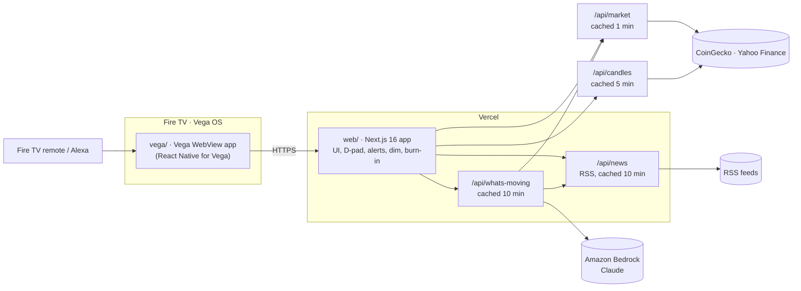

# ChartsTV

**An always-on market screen for Fire TV.** It shows your watchlist, live headlines and price alerts, reads from across the room, and is driven entirely by the remote.

**Live:** https://chartstv.vercel.app (best viewed full screen at 1920×1080, or on a Fire TV).

Built for the [Build, Ship, Shape: Amazon Developer Hackathon](https://amazonappdev2026.devpost.com/) (Fire TV track) and runs on **Vega OS** and the **Vega Virtual Device**.

## Features

| | What it does |
|---|---|
| **Always-on layout** | Pure black screen with a large clock and date, a chart panel, a watchlist column and a news strip. Everything is sized in rem tied to the viewport, so it reads the same from 10 ft on any TV. |
| **D-pad focus system** | Remote navigation runs on app state instead of the WebView's spatial navigation. One highlight springs from tile to tile with a green or red glow. Up and Down move it, and OK puts a coin in the chart panel. |
| **Candlestick chart** | The chart panel shows 30-minute candles for the selected symbol: 24 hours for crypto, 5 trading days for AMZN. It's drawn as plain SVG, sized for 10 ft, with round-number gridlines and a dashed live-price line that tracks the watchlist price. |
| **Phone companion** | The TV shows a QR code and pairing code. Scanning it opens a phone remote where you **type or speak** commands ("show solana", "pause", "alert me if bitcoin drops 5 percent"), and the TV reacts within seconds. Built with **Kiro Crew** (see below). |
| **Auto-rotation** | Left alone, the chart panel advances every 10 s with a countdown bar. Using the remote pauses it, and it resumes after 30 s idle. |
| **Media buttons + Alexa** | Play/Pause stops or starts rotation, and fast-forward and rewind skip coins, with a large on-screen badge. The same actions are registered with the Media Session API, which Alexa voice commands use. |
| **Price alerts** | Full-width green or red banner with a synthesized chime. Alerts fire once per crossing of a price level or a big daily move (3% for AMZN, 5–8% for crypto). |
| **Live prices** | AMZN plus five major coins, refreshed every minute: crypto from CoinGecko, AMZN from Yahoo Finance. Fetched server-side and shared by every TV, and any provider can fail without leaving gaps on the board. |
| **Live news ticker** | Headlines from About Amazon, Yahoo Finance (Amazon stories), CoinDesk and Cointelegraph. Cached server-side for 10 minutes and scrolled smoothly with a CSS transform. |
| **What's moving (Bedrock)** | A short market summary written by **Claude on Amazon Bedrock**, grounded only in the board and the headlines. It falls back to a plain price summary if Bedrock is unavailable. |
| **Night dim** | From 22:00 to 07:00 the screen dims to about 45%. Alerts stay at full brightness above the dim layer. |
| **Burn-in protection** | The whole layout drifts 6 px to a new position every 2 minutes, cycling through 9 positions. |

### Remote controls

| Button | Action |
|---|---|
| ▲ / ▼ | Move the focus highlight through the watchlist |
| OK | Show the focused coin in the chart panel |
| ⏯ Play/Pause | Stop or start auto-rotation |
| ⏩ / ⏪ | Next / previous coin |
| Back | Not intercepted by the app |

## Architecture



- **`vega/`** is a thin Vega WebView wrapper. It loads the web app, passes remote keys through, and forwards the page's console output into the device log (`[web]` lines in `vega device start-log-stream`), which makes the page debuggable on the VVD.
- **`web/`** is the whole UI: a Next.js 16 app with Cache Components. The page is statically prerendered, and the two API routes cache their upstream calls for 10 minutes, so every TV shares one fetch.
- **Bedrock** is called through `AnthropicBedrockMantle` from `@anthropic-ai/bedrock-sdk` with structured output. Credentials come from the standard AWS chain.

## Run it

### Web app

```bash
cd web
npm install
npm run dev      # http://localhost:3000
npm test         # vitest: alerts, RSS parsing, what's-moving, night dim, pixel shift
npm run lint
npm run build
```

Useful URL flags:

| Flag | Effect |
|---|---|
| `?demo=1` | Scripted price moves for demos, relative to live prices: AMZN breaks the next $5 level at 15 s, and DOGE drops through a level 3% below at 30 s |
| `?sound=0` | Mute the alert chime |
| `?dim=on` / `?dim=off` | Force night dim on or off (otherwise 22:00–07:00 local time) |
| `?shift=fast` | Burn-in drift every 3 s instead of every 2 minutes |
| `?news=amazon` | Only About Amazon headlines in the ticker |

#### Optional: live "What's moving" with Amazon Bedrock

Without AWS credentials, the panel shows a price summary. To use Claude:

1. In an AWS account with Bedrock access to an Anthropic Claude model, sign the CLI in with `aws login` or `aws configure`. For a deployment, set `AWS_ACCESS_KEY_ID` and `AWS_SECRET_ACCESS_KEY` instead.
2. Set `AWS_REGION` (default `eu-north-1`) and optionally `BEDROCK_MODEL` (default `anthropic.claude-opus-5-5`; for example `anthropic.claude-sonnet-5`). Put them in `web/.env.local` or in your host's environment.

### Fire TV / Vega Virtual Device

See **[`vega/README.md`](vega/README.md)** for installing the Vega SDK, building the `.vpkg` and running it on the Vega Virtual Device. In short:

```bash
source ~/vega/env
vega virtual-device start
cd vega && npm install && npm run build:debug
vega run-app build/aarch64-debug/chartstv_aarch64.vpkg com.chartstv.chartstv.main -d VirtualDevice
```

The wrapper loads the URL in `APP_URL` in `vega/src/App.tsx`, which is the production deployment at **https://chartstv.vercel.app**.

### Phone companion (optional)

The phone remote needs a small Redis store to pass commands from the phone to the TV. On Vercel, add **Upstash for Redis** from the Marketplace to the project. It sets `KV_REST_API_URL` and `KV_REST_API_TOKEN`; plain `UPSTASH_REDIS_REST_URL` and `UPSTASH_REDIS_REST_TOKEN` work too. Without them the QR code is hidden and everything else works. Commands expire after 1 hour, are rate-limited to 30 a minute per TV, and the TV polls every 5 s, or every 1 s for two minutes after a command.

## Built with Kiro Crew

The phone companion was implemented by **[Kiro Crew](https://kiro.dev/docs/crew/)**, AWS's autonomous agent workspace for Kiro, running locally with Kiro CLI:

1. We wrote the spec, [`docs/specs/phone-companion.md`](docs/specs/phone-companion.md), with requirements, architecture, tests and acceptance criteria.
2. Kiro Crew implemented it end to end on a branch: the command parser, pairing codes, the Redis relay and API, adaptive polling, the dashboard wiring and the phone page, with tests.
3. We reviewed the result, fixed the issues we found (Redis auto-deserialization, id sequencing, and where the QR code sits), and verified it against a real Upstash Redis.

## Repository layout

```
web/                 Next.js app (UI + API routes)
  app/components/    clock, dashboard, watchlist, candle chart, alert banner, news ticker, what's moving, night dim, burn-in
  app/lib/           pure logic + tests (market, candles, alerts, rss, whats-moving, dpad, night-dim, pixel-shift)
  app/api/           /api/market, /api/candles, /api/news, /api/whats-moving, /api/remote/[code]/commands
  app/remote/        the phone remote page (/remote/[code])
vega/                Vega WebView wrapper for Fire TV (see vega/README.md)
docs/
  specs/             feature specs (phone companion, built with Kiro Crew)
  friction-log.md    every snag we hit with the Vega SDK, the VVD and Bedrock
  feedback.md        product feedback for each tool and SDK we used
```

## Known limitations

- **AMZN comes from Yahoo Finance's unofficial chart endpoint.** It needs no key, but it isn't a published API. If it fails, AMZN keeps its last value. Crypto prices come from CoinGecko's free public API.
- **Alexa voice is untested.** The Vega Virtual Device can't inject voice commands. The remote's media buttons are tested; the voice path relies on the documented Media Session integration.
- **The screensaver still starts after 5 minutes without remote input** on a real Fire TV. We couldn't find a supported way for a non-video app to keep the screen awake; details are in `docs/friction-log.md` (entries 12–13).
- **Bedrock access depends on the AWS account.** AWS support told us our new account needs spend and usage history before it can use Anthropic models (friction-log entries 14–17). The panel falls back to a price summary until it runs on an account with access.

## Credits

- Each headline in the ticker is labeled with its publisher: About Amazon, Yahoo Finance, CoinDesk or Cointelegraph.

## License

[MIT](LICENSE)
